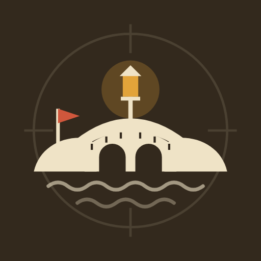
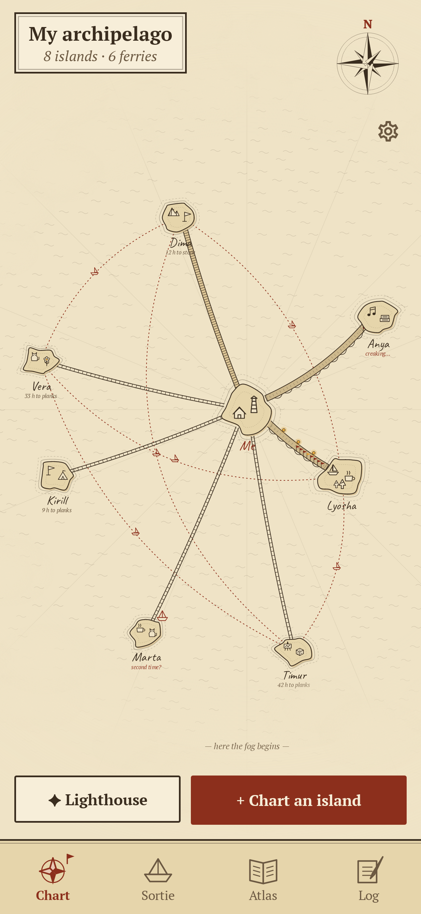
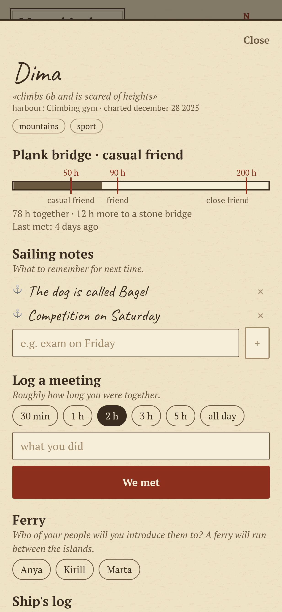
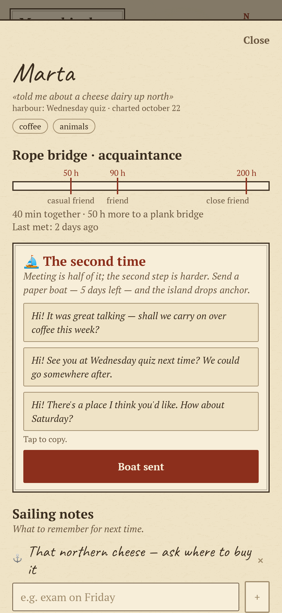
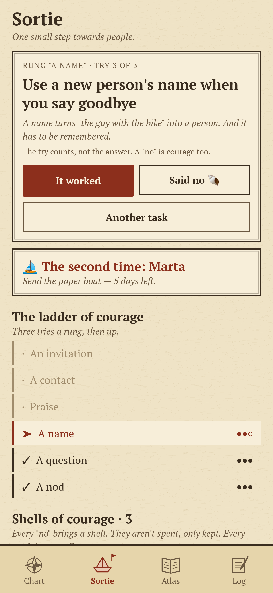
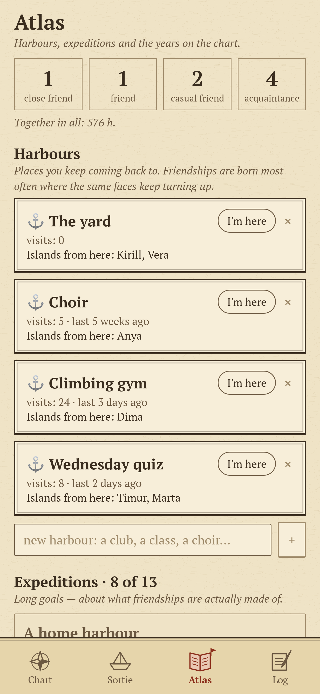
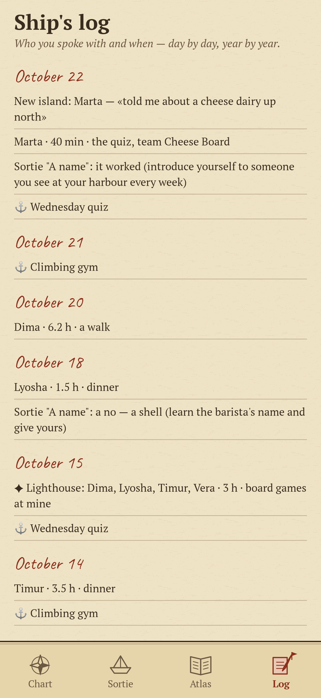

<div align="center">



# Archipelago

### Make friends the way it actually works — and keep them for years.

*It takes about 50 hours together for an acquaintance to become a casual friend, about 90 for a friend and over 200 for a close friend (Jeffrey Hall, 2018). So meeting people isn't enough — you have to come back. Archipelago is an old sea chart of your people: small sorties of courage to meet them, bridges that grow with every hour together, and fog that comes in when you stop. Free, no ads, no account, no internet.*

[](https://github.com/bigdevwhale/archipelago/actions/workflows/android.yml)
[](https://github.com/bigdevwhale/archipelago/releases/latest)


[](LICENSE)

**English** · [Русский](README.ru.md) · [Changelog](CHANGELOG.md)

     

</div>

---

## How it works

1. **You are the island in the middle.** Every person you meet becomes an island around you. No photo — a name, one detail that stuck, and up to four things they love, drawn as little landmarks on the shore.
2. **Sorties.** A ladder of courage in ordinary life: a nod, a question, a name, praise, a contact, an invitation — three tries a rung, then the open sea. The try counts, not the answer: every "no" brings a shell of courage, and every tenth shell is a nautilus.
3. **The second time.** Once you've met, there's a week for the second step, the hardest part of any friendship. A paper boat waits on the new island with ready messages to copy; send one and the island drops anchor. Miss the week and it drifts — it's never too late.
4. **Hours build bridges.** Log roughly how long you were together. The bridge grows from rope to planks (50 h), stone arches (90 h) and a lantern arch (200 h), and the island drifts closer.
5. **Creaking and fog.** A month without meeting and the bridge sags and creaks. Half a year without a word and the island is lost in the fog — one message brings it back.
6. **Ferries and the lighthouse.** Introduce two of your people and a ferry runs between their islands. Have people over and light the lighthouse: everyone gets the hours, and those who hadn't met get a ferry too.
7. **Sailing notes.** A few lines to remember for next time — the exam on Friday, the dog's name.
8. **Harbours.** Places you keep coming back to — a class, a choir, the yard. Friendships are born where the same faces keep turning up; mark your visits.
9. **Kept for years.** A pennant on the bridge for every year known, anniversaries, a summary of every year in the Atlas, thirteen long expeditions, and a ship's log of everything. The whole chart saves to one JSON file for the next phone.
10. **One evening look.** At most one notification a day, around 18:30, and only when it matters: a paper boat not yet sent, a bridge just starting to creak, an anniversary.

## Build

```
./gradlew testDebugUnitTest assembleDebug
./gradlew -Pdemo assembleDebug          # app.mostki.demo with a year of islands already lived
./gradlew testDebugUnitTest -Prender --tests '*RenderArt*'   # screens and the icon to app/build/art
```

The chart is drawn in code (`ui/art`) like an engraving: hatched water, inked coasts, rope, plank, stone and lantern bridges, fog.

Fonts: PT Serif (ParaType) and Caveat (Impallari Type), both under the SIL Open Font License.
