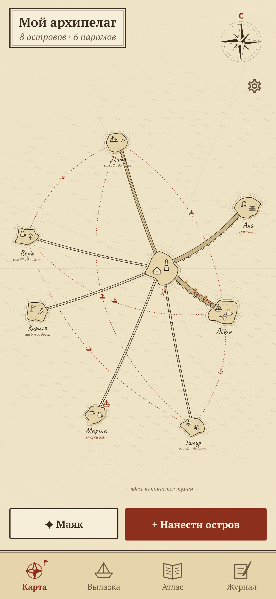
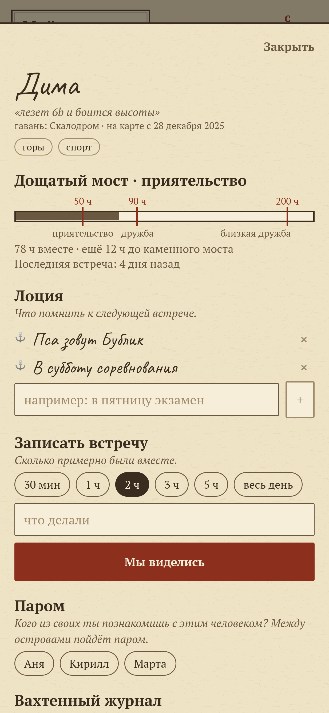
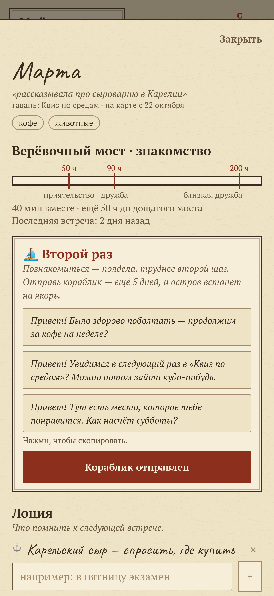
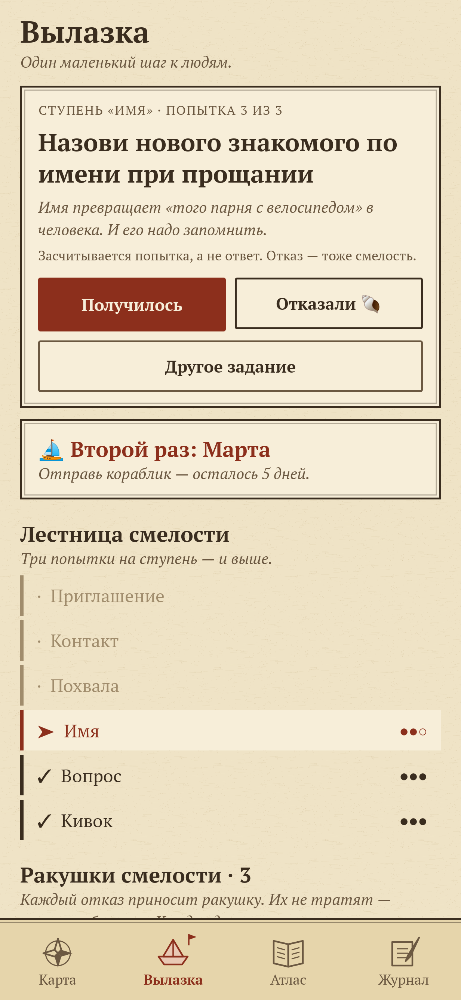
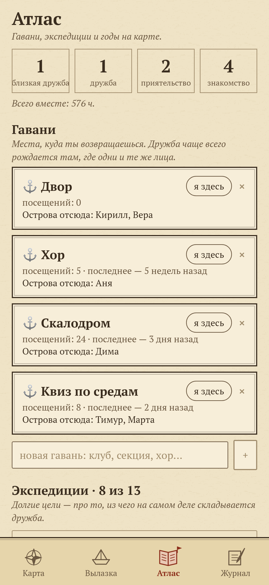
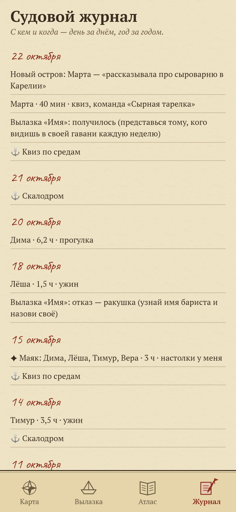

<div align="center">


# Мостки

### Заводить друзей так, как это на самом деле работает, — и не терять их годами.

*Чтобы знакомый стал приятелем, нужно около 50 часов вместе, другом — около 90, близким другом — больше 200 (Джеффри Холл, 2018). Значит, мало познакомиться — надо возвращаться. «Мостки» — старинная морская карта твоих людей: маленькие вылазки смелости, мосты, которые растут с каждым часом вместе, и туман, который приходит, если перестать. Бесплатно, без рекламы, аккаунтов и интернета.*

[](https://github.com/bigdevwhale/archipelago/actions/workflows/android.yml)
[](https://github.com/bigdevwhale/archipelago/releases/latest)

[](LICENSE)

[English](README.md) · **Русский** · [Изменения](CHANGELOG.md)

     

</div>

---

## Как это устроено

1. **Ты — остров в центре.** Каждый новый человек — остров вокруг. Без фото: имя, одна запомнившаяся деталь и до четырёх увлечений, нарисованных на берегу.
2. **Вылазки.** Лестница смелости в обычной жизни: кивок, вопрос, имя, похвала, контакт, приглашение — по три попытки на ступень, потом открытое море. Засчитывается попытка, а не ответ: за каждое «нет» — ракушка смелости, каждая десятая — наутилус.
3. **Второй раз.** После знакомства есть неделя на второй шаг — самое трудное в дружбе. На новом острове ждёт бумажный кораблик с готовыми сообщениями; отправь — и остров встанет на якорь. Неделя прошла — остров дрейфует, но поздно не бывает.
4. **Часы строят мосты.** Записывай, сколько примерно вы были вместе. Мост растёт: верёвка, доски (50 ч), каменные арки (90 ч), арка с фонарями (200 ч) — и остров подплывает ближе.
5. **Скрип и туман.** Месяц без встречи — мост провисает и скрипит. Полгода без слова — остров уходит в туман; вернуть его можно одним сообщением.
6. **Паромы и маяк.** Познакомь двоих своих — между островами пойдёт паром. Собери людей у себя и зажги маяк: всем — часы, а незнакомым между собой — паром.
7. **Лоция.** Пара строк к следующей встрече: экзамен в пятницу, как зовут собаку.
8. **Гавани.** Места, куда ты возвращаешься, — секция, хор, двор. Дружба рождается там, где одни и те же лица; отмечай визиты.
9. **На годы.** Флажок на мосту за каждый год знакомства, годовщины, итоги каждого года в Атласе, тринадцать долгих экспедиций и судовой журнал. Вся карта сохраняется в один JSON-файл для следующего телефона.
10. **Один вечерний взгляд.** Не больше одного уведомления в день, около 18:30, и только по делу: кораблик не отправлен, мост начал скрипеть, годовщина.

## Сборка

```
./gradlew testDebugUnitTest assembleDebug
./gradlew -Pdemo assembleDebug          # app.mostki.demo с прожитым годом островов
./gradlew testDebugUnitTest -Prender --tests '*RenderArt*'   # экраны и иконка в app/build/art
```

Шрифты: PT Serif (ParaType) и Caveat (Impallari Type), оба под SIL Open Font License.
